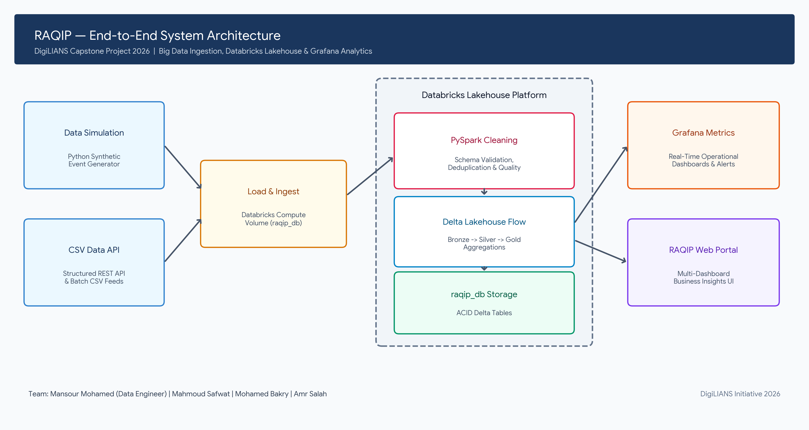
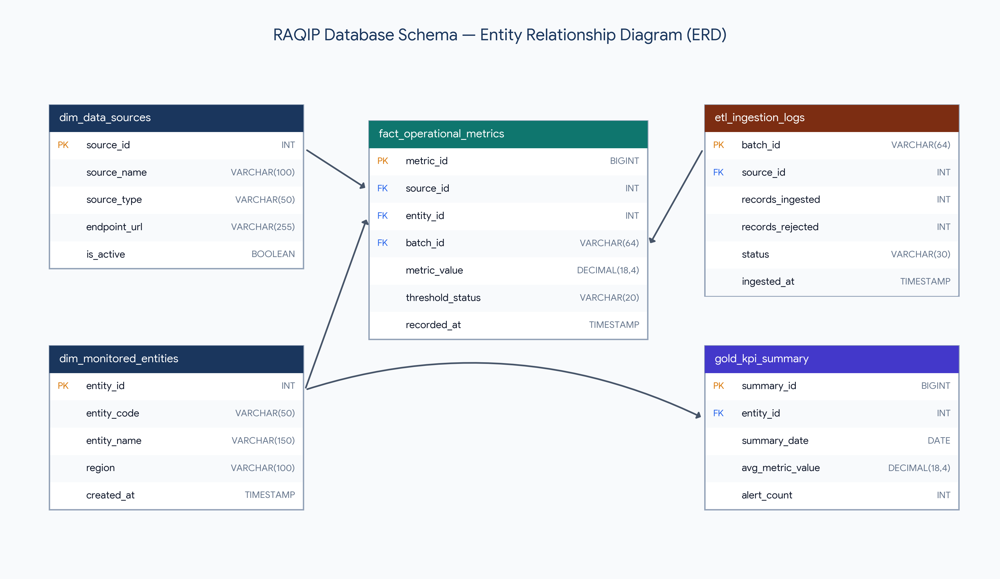

# 🛡️ RAQIP — End-to-End Big Data & Analytics Platform

**RAQIP** is a professional-grade, multi-dashboard data engineering and analytics portal designed to ingest, process, store, and visualize operational and business metrics at scale.

*(Developed as part of the Digital Pioneers Initiative - DigiLIANS Capstone Project 2026)*

---

## 🏗️ System Architecture



### 🔄 Data Pipeline Flow
1. **Data Sources:** Combines real-time/batch **Data Simulation** and structured **CSV Data API** feeds.
2. **Load & Ingestion (`raqip_db`):** Automated batch ingestion pipelines loading raw data into Databricks Compute Volumes.
3. **Transformation Layer (Databricks & PySpark):** Distributed data processing using **PySpark** and **Delta Lakehouse** flows for cleansing, schema enforcement, and aggregation.
4. **Storage Layer:** Persistent, ACID-compliant storage in **Delta Lake (`raqip_db`)**.
5. **Serving & Visualization:** Real-time operational metrics served via **Grafana** and interactive business insights displayed on the **RAQIP Web Portal**.

---

## 🗄️ Database Schema (ERD)



---

## 👨‍💻 My Key Contributions (Data Engineering Role)

As a **Data Engineer** on the RAQIP team, I was responsible for the core data foundation and ingestion lifecycle:
* **Database Schema Design:** Architected the relational and analytical database schemas (`raqip_db`), defining primary/foreign keys, relationships, and indexing strategies to ensure high query performance and data integrity.
* **Data Ingestion Pipelines:** Engineered automated Python and SQL ingestion workflows to extract data from simulated sources and CSV APIs, validating records before loading them into Databricks.
* **Data Quality & Validation:** Implemented schema checks and deduplication rules during ingestion to prevent schema drift and corrupted data entries.

---

## 🛠️ Tech Stack

* **Languages:** Python, SQL
* **Big Data & Processing:** Apache Spark (PySpark), Databricks, Delta Lakehouse
* **Data Ingestion & APIs:** REST APIs, CSV Batch Processing, Data Simulation
* **Monitoring & BI:** Grafana, Multi-Dashboard Web Portal
* **Version Control:** Git, GitHub

---

## 🚀 Getting Started

### Prerequisites
* Python 3.9+
* Apache Spark / Databricks Workspace
* Grafana (for operational metrics visualization)

### Installation & Setup
1. Clone the repository:
   ```bash
   git clone https://github.com/Mansour-Al-Bahnassawi/RAQIP-Data-Architecture-Pipeline.git
   cd RAQIP-Data-Architecture-Pipeline
   ```
2. Install required dependencies:
   ```bash
   pip install -r requirements.txt
   ```
3. Run the database schema setup scripts located in `database_schema/` and execute the ingestion pipeline via `ingestion/api_csv_ingestion.py`.

---

## 👥 Project Team
* **Mansour Mohamed** — Data Engineer (Database Schema & Data Ingestion)
* **Mahmoud Safwat**
* **Mohamed Bakry**
* **Amr Salah**

---

## 📫 Contact
* **GitHub:** [@Mansour-Al-Bahnassawi](https://github.com/Mansour-Al-Bahnassawi)
* **LinkedIn:** [Mansour Mohamed](https://www.linkedin.com/in/mansour-el-bahnassawy)
